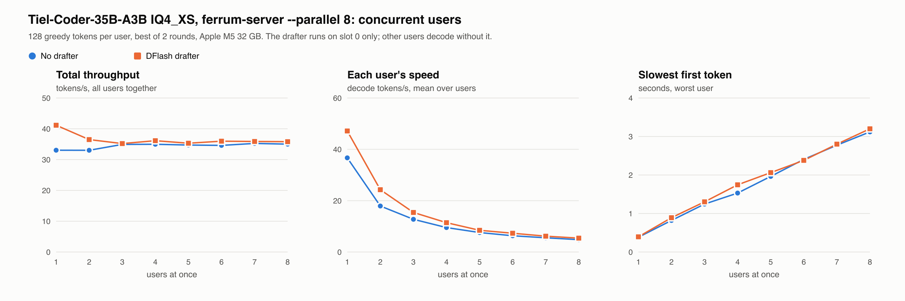

# Parallel slots and per-request image sizes, October 2026

Regression checks for `feat/parallel-slots-image-options` against `experimental` at `12a6e09`, 25–26 October 2026. Machine: 32 GB Apple M5, macOS 27.0.1. Reference: llama.cpp from Homebrew (`/opt/homebrew/bin/llama-perplexity`). Models: Qwen3.8-27B UD-Q4_K_XL (dense hybrid), Tiel-Coder-35B-A3B UD-IQ4_XS (MoE hybrid) with its `mmproj-BF16.gguf`, Spark-X2.6-4B Q4_K_M (attention only). One model in memory at a time; the bench ran under `caffeinate -dims` after `scripts/phase7a_cpu_preflight.py`, with the screen unlocked for every run (logged per run).

The scripts are next to the results: [check.py](check.py) (greedy chat requests through `ferrum-server`, sequential or all at once, then a retry and a second turn), [compare.py](compare.py) and [vision.py](vision.py) (one picture at several image budgets).

## Correctness

| Check | Result | Raw |
|---|---|---|
| Greedy server output, 1 / 4 / 8 slots vs base | identical: Spark 8/8, Qwen 27B 9/9, Tiel 9/9 at every slot count, requests sent at once for 4 and 8 | [server-parity.txt](server-parity.txt) |
| Same with a DFlash drafter (Tiel, ornith-ai/Ornith-1.5-35B-A3B-DFlash), 1 and 4 slots | identical 9/9; six more interleaved runs at 128 tokens identical too | [server-parity.txt](server-parity.txt) |
| Cache kept per conversation | retry of the first request, after 8 others: 1 slot reuses 0/24 (Qwen), 0/202 (Tiel); 8 slots reuse 23/24 and 201/202. Second turn of the long prompt: 1 slot 0, 4 and 8 slots 2,278/2,300 (Qwen) and 2,473/2,495 (Tiel) | [server-parity.txt](server-parity.txt) |
| KLD vs llama.cpp Metal (8 chunks of 512, Ferrum docs corpus) | unchanged to every printed digit: Tiel 0.006826 (95.98% top-1, PPL 17.5253 vs 17.5205); Qwen 27B 0.000001 (99.95%, PPL 10.2536 vs 10.2524), base and branch twice each | [kld.txt](kld.txt) |
| `hybrid_session_check` | PASS on Tiel, Tiel with DFlash, Qwen 27B | [session-spec-checks.txt](session-spec-checks.txt) |
| `hybrid_spec_check` | Qwen 27B output == greedy; Tiel one near-tie at token 59 (margin 0.0012), the same on the base | [session-spec-checks.txt](session-spec-checks.txt) |
| Memory plan vs Metal (`ferrum hybrid --raw --prompt hi`) | within 3 MiB on both | [plan-check.txt](plan-check.txt) |
| Image budgets (Tiel vision, 1600x1200 picture, `--image-tokens 1024`) | default output identical to base. Image tokens (prompt minus 199 text tokens): default 972, `detail: low` 234, `max_tokens: 300` 300, `image_max_tokens: 400` 391; a part's `detail: high` beats the request's `image_detail: low`; `max_tokens: 100000` clamps to the cap; `detail: "huge"` and `max_tokens: 0` return 400. The encoder ran 4 times for 8 accepted requests (cache keyed by limits) | [vision-budgets.txt](vision-budgets.txt) |

With 8 slots of 8,192 tokens the Qwen 27B does not fit (24,896 MiB against a 23,552 MiB budget) and the server refuses to load, naming the largest context that fits (5,376); the 8-slot run used `-c 4096`.

## Performance

`hybrid_bench --pp 512,2048 --tg 128`, base and branch interleaved A-B-B-A, two rounds (four runs each). The bench calls the model directly, so it covers the memory planner and shared code but not the server's scheduler; the drafter runs above cover that path.

| Model | Test | Base best (range) | Branch best (range) |
|---|---|---|---|
| Tiel | pp512 | 864.8 (824.2–864.8) | 892.3 (842.6–892.3) |
| Tiel | pp2048 | 851.8 (805.1–851.8) | 820.5 (800.3–820.5) |
| Tiel | tg128 | 39.12 (38.19–39.12) | 38.66 (37.78–38.66) |
| Qwen 27B | pp512 | 186.3 (157.6–186.3) | 190.4 (149.3–190.4) |
| Qwen 27B | pp2048 | 182.6 (155.8–182.6) | 183.9 (158.9–183.9) |
| Qwen 27B | tg128 | 7.30 (6.28–7.30) | 7.31 (6.47–7.31) |

The branch's best is inside the base's range everywhere, apart from Tiel pp512, where the branch was faster. The base's best pp2048 on Tiel is its first run; its other three were 805–812. Raw: [regression-abba.txt](regression-abba.txt).

Through the server with the Tiel drafter (mean decode tok/s over 9 requests, 128 tokens, base, branch, branch, base, base, branch): base 46.0, 41.1, 42.2; branch 47.4, 40.7, 48.6.

Parallel slots interleave requests rather than batch them, so total throughput stays the same as one slot (Spark: 18.4 s for 8 requests with 1 slot, 18.5 s with 8), and each request's own rate drops while it shares the GPU.

## Concurrent users (Tiel)

`ferrum-server --parallel 8 -c 8192 --mmproj none`, with and without `--draft` ornith-ai/Ornith-1.5-35B-A3B-DFlash, 26 October 2026, screen unlocked, under `caffeinate -dims`. [conc.py](conc.py) sends N streaming chat requests at once (219-token prompts, each tagged so nothing comes from cache, 128 greedy tokens each), two rounds per N; [plot_conc.py](plot_conc.py) plots the round with the higher total.

| Users | No drafter: total tok/s | per user | worst first token (s) | DFlash: total tok/s | per user | worst first token (s) |
|---|---|---|---|---|---|---|
| 1 | 33.0 | 36.7 | 0.38 | 41.2 | 47.1 | 0.39 |
| 2 | 33.0 | 17.9 | 0.82 | 36.5 | 24.3 | 0.89 |
| 4 | 35.0 | 9.5 | 1.53 | 36.1 | 11.4 | 1.75 |
| 8 | 35.0 | 4.8 | 3.12 | 35.8 | 5.4 | 3.20 |

Total throughput stays flat because slots interleave rather than batch: N users share one decode stream. The drafter runs on slot 0 only, so its gain shrinks to slot 0's share as users are added. The first token waits for every request that arrived at the same time to prefill (one 219-token chunk each, about 0.38 s). Raw: [concurrency-tiel.txt](concurrency-tiel.txt), [concurrency-tiel-best.txt](concurrency-tiel-best.txt).

## Cache per user (Tiel)

[cache.py](cache.py): 8 users, each with its own ~1,280-token system prompt. Turn 1 and turn 2 send all 8 at once; turn 3 is user 0 alone, after everyone's turn 2.

| | `--parallel 8` | `--parallel 1` |
|---|---|---|
| Turn 2, cached / prompt tokens (8 users) | 10,271 / 10,431 | 0 / 10,431 |
| Turn 3 (user 0), cached / prompt | 1,307 / 1,331 | 0 / 1,331 |
| Turn 3 prompt time | 145 ms | 1,895 ms |
| `/slots` after turn 3 | 8 slots holding 1,307–1,355 tokens each | 1 slot, the last conversation |

Raw: [cache-per-user.txt](cache-per-user.txt).
